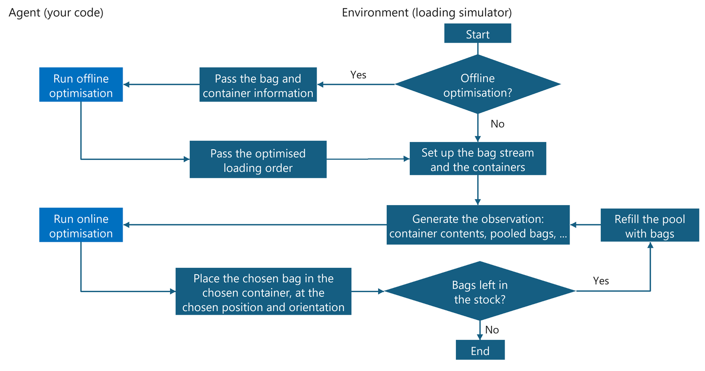

# StowSim Specification

This document is the detailed specification of the simulator, its modules, the agent interface and the evaluation. For an overview and a quick start see the [project README](../README.md).

StowSim is a physics-based loading environment for side-opening containers, built on PyBullet. It follows the Gymnasium API, and its purpose is to develop agents that decide the best placement from the observations the environment provides.

- PyBullet: the physics simulation engine
- Physics-based: the simulator moves through states according to the laws of physics
- Gymnasium API: the environment interface commonly used by reinforcement-learning libraries
- Observation: the state information an agent receives from the environment
- Agent: an algorithm that decides actions

## Repository structure

```bash
stowsim
├── stowsim/               : the simulator package (environment, validator, camera, evaluator, runner)
├── agents/                : agent implementations (base template, reference agent, experimental agents)
├── configs/               : task configurations and the bag-type parameter table
├── docker/                : Dockerfile and docker-compose definition of the runtime environment
├── docs/                  : documentation (this specification, architecture, agent guide, tools guide)
├── scripts/               : command-line entry points (run an agent on a configuration)
├── tests/                 : unit and smoke tests
├── tools/                 : development tools (in-process runner, fast simulation, batch evaluation, visualizer)
└── README.md              : project overview
```

## Specification of the simulation modules

### Overview

The simulator consists of several modules and is initialised from the values in a JSON configuration file (for example `config.json`). See also sources such as `stowsim/env.py`.

The configuration file has the structure below. The settings for each module are stored under a task ID (for example `"001"`). See also `configs/sample_config.json`.

```json
{
    "001": {
        "containers": {
            "spacing": 2.0,
            "container_list": [
                {
                    "index": 0, "length": 1.0, "width": 1.5, "height": 1.0, 
                    "thickness": 0.02, "require_shelf": false, "buffer": 0.01,
                    "cut_x": 0.3, "cut_y": 0.3, "packed_items": [], "is_prioritized": false
                }
            ]
        },
        "item_stream": {
            "item_list": [
                {
                    "index": 0, "length": 0.2, "width": 0.2, "height": 0.2, "mass": 1.0,
                    "is_prioritized": false, "lateralFriction": 0.8, "rollingFriction": 0.01,
                    "spinningFriction": 0.01, "restitution": 0.0
                }
            ],
            "look_ahead": 5,
            "max_space": 1,
            "visible_pool": []
        },
        "validator": {
            "safety_margin": 0.01,
            "displacement_threshold": 0.9,
            "settle_wait_step": 300,
            "start_z": 0.03
        },
        "camera": {
            "num_containers": 1, "target_pos": [0, 0, 0], "distance": 3.0,
            "yaw": 0, "pitch": 0, "roll": 0, "img_width": 64, "img_height": 64,
            "fov": 60, "near_val": 0.1, "far_val": 10.0
        },
        "action": {
            "keys": {"item_idx": "int", "container_idx": "int", "place_pos": "float", "orientation": "int"},
            "pos_lim": {"low": -100, "high": 100},
            "orientations": [0, 1, 2, 3, 4, 5]
        },
        "agent": {
            "optimize": false,
            "init_timeout": 10.0, "optimization_timeout": 10.0, "policy_timeout": 10.0,
            "allowed_methods": ["get_init_states", "optimize", "policy"]
        },
        "visualizer": {
            "vis": false,
            "camera": { "img_width": 128, "img_height": 128 }
        }
    },
    ...
}

```

The keys that correspond to each module are as follows.

| Module (configuration key) | Main functions |
| --- | --- |
| **`containers`** (MultiContainerManager) | - creates side-opening containers with the given dimensions<br>- arranges multiple containers (offset management)<br>- keeps the state of the bags inside the containers |
| **`item_stream`** (ItemStreamManager) | - defines the physical properties of the bags (cuboids)<br>- manages the order of bags arriving like on a conveyor<br>- provides the "pool" the agent can choose from |
| **`validator`** (PlacementValidator) | - checks that a bag does not stick out of the container<br>- checks that no other bag blocks the push-in trajectory<br>- checks that the bag does not collapse right after placement |
| **`camera`** (Camera) | - generates the depth map (height image) used as the agent's observation |
| **`visualizer`** (Camera) | - generates and saves RGB images of the whole simulation for debugging and checking behaviour |
| **`action`** (GroundHandlingEnv, PlacementValidator) | - defines the constraints on, and the validation of, the action data received from the agent |
| **`agent`** (TimedAgentRunner) | - defines the timeouts and the permitted methods used when running the agent |

### Coordinate system and units

The following physical units and coordinate system are used.

- **Units**: all lengths and coordinates are in metres `[m]`, mass is in kilograms `[kg]`, time is in seconds `[s]`.
- **Coordinate system (Z-up, right-handed)**:
    - **X axis**: width direction of the container (left-right)
    - **Y axis**: depth direction of the container (front to back). The opening (front) is on the negative side of Y.
    - **Z axis**: height direction (up-down). Positive Z is up.

### `GroundHandlingEnv` (integrated environment)

The main Gymnasium-compatible class that manages the whole simulation environment.

| Item | Description |
| --- | --- |
| **Main functions** | - initialises and manages the submodules<br>- resets an episode (`reset`) and executes a step (`step`)<br>- provides observations to the agent<br>- manages the transfer of image data |
| **Information passed (config)** | root dictionary containing the settings of every module<br>(including `containers`, `item_stream`, `camera`, `validator`, `action`, `agent`, `visualizer`, ...) |

- Setting `render_mode` to "human" lets you watch the simulation in a GUI.
- You can also check the actual movement as still images after the run.
    1. Change `"visualizer": { "vis": false }` to `"vis": true`.
    1. Add the parameters for the shooting conditions under "camera" (same as for [Camera](#camera-depth-map--visualisation)).
    1. When the simulation runs, per-step images (bird's-eye views) are saved in the `images/steps/YYYYMMDD_HHMMSS/` directory.

Note: saving images can slow the execution down considerably. Enable it only while checking the behaviour of an algorithm, and set it back to `false` when running many tests.

### `TimedAgentRunner` (agent management)

Manages the time limits and the functions an agent has to implement. See [below](#agent-specification) for the agent specification.

| Item | Description |
| --- | --- |
| **Main functions** | - defines the timeouts used when running the agent and the methods it is allowed to run |
| **Information passed (config)** | - `init_timeout`, `policy_timeout`, `optimization_timeout`: time limit per call of each method (instantiation, policy execution, optimisation execution respectively)<br>- `allowed_methods`: names of the methods the agent may run<br>- `max_mem`: upper limit of memory use (`[GB]`) |

- The default settings are `init_timeout`: 10 `[s]`, `policy_timeout`: 8 `[s]`, `optimization_timeout`: 180 `[s]`, `max_mem`: 12 `[GB]`.
- When a time limit is exceeded, the processing is forcibly aborted and the following fallbacks are executed automatically.
    - On an `optimize` timeout: the order of the bags is not changed and the original stream order is used.
    - On a `policy` timeout: an action with a random position and orientation in the space is returned.

### `MultiContainerManager` / `Container` (container management)

Creates the containers to load and manages their state.

| Item | Description |
| --- | --- |
| **Main functions** | - creates side-opening containers with the given dimensions in the physics world<br>- arranges multiple containers side by side (offset management)<br>- keeps the position and orientation of the bags loaded in each container |
| **Information passed (config)** | - `spacing`: spacing between containers `[m]`<br>- `container_list`: list of containers<br>  - `index`: identification ID<br>  - `length`, `width`, `height`: container dimensions, where `length`: width (X direction, outer size), `width`: depth (Y direction, outer size), `height`: height (Z direction, outer size)<br>  - `thickness`, `buffer`: thickness of the inner wall and height buffer `[m]`<br>  - `cut_x`, `cut_y`: cut-out dimensions of the opening `[m]`, where `cut_x`: width (X direction, outer size), `cut_y`: height (Z direction, outer size). This is the picture seen along the Y axis. Check it in GUI mode as well.<br>  - `packed_items`: list of bags already loaded. Each element follows `Item`.<br>  - `is_prioritized`: whether the container is for priority bags<br>  - `require_shelf`: whether there is an internal shelf |

- The Y axis is the depth direction of the container, and the container is created with its opening on the negative Y side.
- When the container is created in the physics world, the (unit) normal vectors `n_vec` pointing outwards from each inner wall face, the coordinates `points` of the corresponding representative points, the container centre `center` and the usable volume `volume` are calculated.
- When two or more containers are created, they start at the origin `(0, 0, 0)` and are created in the same orientation with a gap of `spacing` along the X axis. That is, for each container `offset_x` = `i*spacing`, and `(offset_x, 0, 0)` is its origin (`i` is the index from 0 to the number of containers - 1).
- A small shelf is also created at the position (`length`/2 + `cut_x`/2 + `thickness`, 0, `height`/2 + `thickness`/2 + `buffer`) as a cuboid with the dimensions (`cut_x`, `width` - 2*`thickness`, `thickness`).
- When `require_shelf` = `True`, a shelf is created at the position (0, `width`/4, `height`/2 + `thickness`/2 + `buffer`) as a cuboid with the dimensions (`length` - `thickness`, `width`/2 - 2*`thickness`, `thickness`).

### `ItemStreamManager` / `Item` (bag stream management)

Manages the list of bags to load and the "pool" visible to the agent.

| Item | Description |
| --- | --- |
| **Main functions** | - defines and creates the physical properties of the bags (cuboids)<br>- manages the order of the bags arriving like on a conveyor<br>- provides and refills a pool of `look_ahead` bags the agent can currently choose from |
| **Information passed (config)** | - `look_ahead`: maximum number of bags visible at once<br>- `max_space`: threshold for refilling the pool<br>- `item_list`: list of all bags<br>  - `length`, `width`, `height`: bag dimensions (`length`: X direction, `width`: Y direction, `height`: Z direction) `[m]`<br>  - `mass`: mass `[kg]`<br>  - `lateralFriction`, `rollingFriction`, `spinningFriction`, `restitution`, `angularDamping`: friction and physical coefficients (lateral friction, rolling friction, spinning friction, restitution, angular damping respectively)<br>  - `contactStiffness`, `contactDamping`, `linearDamping`: physical coefficients that take effect for soft bags (contact stiffness, contact damping, damping of the translational motion respectively)<br>  - `is_soft`: whether the bag is a soft bag<br>  - `is_prioritized`: whether the bag is a priority bag |

- Soft bag (`is_soft: true`): a soft bag with cushioning. Its stiffness is set low in the physics engine, so it sinks in a little when something heavy is placed on top.
- Priority bag (`is_prioritized: true`): a bag that should get special treatment, for example first-class or transfer baggage.
- `configs/item_params.xlsx` lists the bag types and example parameters for reference.

### `PlacementValidator` (placement validation)

Validates the format of the action specified by the agent (placement coordinates and so on) and whether it is physically possible.

| Item | Description |
| --- | --- |
| **Main functions** | - **Format check**: checks that the type of the specified action and its upper and lower limits are respected<br>- **Inclusion check**: whether the bag sticks out of the container frame<br>- **Insertion path check**: whether another bag blocks the trajectory that pushes the bag to the specified position<br>- **Placement stability check**: whether the bag collapses badly right after placement |
| **Information passed (config)** | - `inclusion_margin`: allowed protrusion `[m]` when judging whether a bag is inside the container<br>- `safety_margin`: margin distance `[m]` to other objects that counts as a collision<br>- `ceiling_margin`: height allowance `[m]` when approaching the ceiling<br>- `displacement_threshold`: allowed distance shift `[m]` before the bag is judged to have collapsed after placement<br>- `angle_displacement_threshold`: allowed rotation shift `[deg]` before the bag is judged to have collapsed after placement<br>- `start_z`: height offset `[m]` at the start of the push-in (the bag is finally dropped gently from that height)<br>- `settle_wait_step`: number of simulation steps to wait for the bag to settle after placement<br>- others: information passed from `action` in `config` (described below) |

The information passed from `action` in the configuration file (`config`) is as follows, and type checks and similar are performed on its basis.

- `keys`: keys and types required in the action dictionary
- `pos_lim`: upper and lower limits of the placement coordinates `[m]`
- `orientations`: list (`int`) of permitted orientation indices. See [the action format](#action-format-return-value-of-policy) for details.

In the insertion path check, the bag starts at the entrance, `start_z` higher than the height of the target position, moves along the Y axis towards the Y coordinate of the target, and then moves along the X axis towards the X coordinate. When the target is close to the ground, a shelf or the ceiling, `start_z` is 0.

The simulator performs the placement validation above at every step. If it fails, the episode ends and is evaluated in that state. The default parameters are as follows.

- `inclusion_margin`: -0.005 `[m]`
- `safety_margin`: 0.015 `[m]`
- `ceiling_margin`: 0.018 `[m]`
- `displacement_threshold`: 0.3 `[m]`
- `angle_displacement_threshold`: 45 `[deg]`
- `start_z`: 0.08 `[m]`
- `settle_wait_step`: 300

### `Camera` (depth map / visualisation)

Photographs the container state and outputs image data. It is instantiated for two uses: observation and visualisation.

| Item | Description |
| --- | --- |
| **Main functions** | **[Observation (depth map)]**<br>- generates a depth map (height image) by orthographic projection from the front of the container<br>- writes it to shared memory as the agent's spatial-awareness data<br><br>**[Visualisation (RGB visualiser)]**<br>- generates and saves RGB images of the whole simulation for debugging and checking behaviour |
| **Information passed (config)** | - `target_pos`: look-at point coordinates<br>- `distance`, `yaw`, `pitch`, `roll`: camera placement and angle<br>- `img_width`, `img_height`: resolution of the output image<br>- `fov`, `near_val`, `far_val`: field of view and imaging range |

- The value of each pixel of the 2-D depth-map array (NumPy) generated for observation is the **physical distance to a bag** seen from the front side (opening) of the container: the smaller the value, the closer to the front the bag is, and the larger the value, the deeper the free gap.
- The shape of the depth-map array is `(number of containers, image height, image width)` (for example `(2, 64, 64)` for two containers and 64x64 pixels). `depth_map[0]` gives the depth map of `container_idx: 0`.
- The default depth-map resolution is 64×64.

The basic flow of the simulation is as follows.



## Agent specification

Create a class that implements the following three methods. **The file name must be `agent.py` and the class name must be `Agent`.**

### Methods to implement and their input/output specification

| Method | When it runs | Main function | Arguments (input format) | Return value (output format) |
| --- | --- | --- | --- | --- |
| `__init__` | before the episode (once) | Creates the agent instance. Loads models or custom settings if necessary. | **`module_path` (`str`)**: path of the directory containing `agent.py` | `None` |
| `get_init_states` | before the episode (once) | Receives the initial environment settings such as the number and dimensions of the containers and the pool specification, and keeps them inside the agent. | **`init_states` (`dict`)**:<br>- `optimize`: whether offline optimisation is used<br>- `lookahead_k`: maximum number of bags visible at once<br>- `container_list`: list with the dimensions, centre coordinates and other information of each container | `None` |
| `optimize` | **when offline optimisation is used**, right after the evaluation starts (once) | **[Offline optimisation]**<br>Looks at the information of all bags and decides the best loading order (the order of the indices). | **`item_list` (`list`)**: <br>list of dictionaries holding the information of all bags (dimensions, mass, index and so on) | **`list[int]`**: list of the rearranged bag index numbers (`item.index`). Return a list in which every bag index appears exactly once. |
| `policy` | every step | **[Online optimisation]**<br>Based on the observation (depth maps and the current pool), decides which bag to place, in which container, at which position and in which orientation. | **`observation` (`dict`)**: <br>- `optimize`: whether offline optimisation is used<br>- `lookahead_k`: maximum number of bags visible at once<br>- `depth_map`: depth map of each container (`numpy.ndarray`)<br>- `pool_list`: list of the information of the bags currently in the pool<br>- `container_list`: list of container information | **`action` (`dict`)**: (see "Action format" below for details) |


The following explains the contents of `container_list`, `item_list` and `pool_list`, which are passed to the agent methods (`get_init_states`, `optimize`, `policy`).

#### `container_list`

It is passed as observation information in the agent's `get_init_states` and `policy` methods. It contains the physical dimensions of the container and the **information of the bags already loaded (`packed_items`)**.

| Key | Type | Description |
| --- | --- | --- |
| `index` | `int` | identification ID of the container (integer starting at 0) |
| `length` | `float` | width of the container (dimension along the X axis) `[m]` |
| `width` | `float` | depth of the container (dimension along the Y axis) `[m]` |
| `height` | `float` | height of the container (dimension along the Z axis) `[m]` |
| `cut_x` | `float` | cut-out dimension of the upper opening along the X axis `[m]` |
| `cut_y` | `float` | cut-out dimension of the upper opening along the Z axis `[m]` |
| `thickness` | `float` | wall thickness of the container `[m]` |
| `center` | `tuple` | centre coordinates of the container (world frame, `(x, y, z)`). |
| `n_vecs` | `list[tuple]` | normal vectors pointing outwards from the inner wall faces of the container. |
| `points` | `list[tuple]` | coordinates of a representative point of the face for each normal vector (world frame, `(x, y, z)`). |
| `volume` | `float` | usable volume of the container `[m^3]`. |
| `shelf` | `bool` | whether the container has an internal shelf (corresponds to `require_shelf` in the config) |
| `is_prioritized` | `bool` | whether the container is for priority bags (for example first class or transfer baggage) |
| `packed_items` | `list[dict]` | list of the information of the bags already loaded in this container. The structure of each dictionary is the same as in `item_list` below. |


#### `item_list` and `pool_list`

* **`item_list`**: the list of **all bags**, passed to the `optimize` method (offline optimisation).
* **`pool_list`**: the list of **bags the agent can currently choose (visible on the conveyor)**, passed in the `observation` of the `policy` method (online placement).

The structure of the elements (the dictionary data of one bag) is exactly the same in both lists.

| Key | Type | Description |
| --- | --- | --- |
| `index` | `int` | identification ID of the bag (integer starting at 0) |
| `length` | `float` | width of the bag (dimension along the X axis) `[m]` |
| `width` | `float` | depth of the bag (dimension along the Y axis) `[m]` |
| `height` | `float` | height of the bag (dimension along the Z axis) `[m]` |
| `mass` | `float` | mass of the bag `[kg]`. It affects the centre-of-gravity calculation. |
| `is_prioritized` | `bool` | whether the bag is a priority bag. Being placed under a standard bag, or placed in a standard container, counts against it. |
| `is_soft` | `bool` | whether the bag is soft. Having a non-soft bag placed on top counts against it. |
| `belongs_to` | `int` or `None` | `container_idx` of the container it is loaded in, if it has already been placed. `None` if it has not been placed (for example in the pool). |
| `pos` | `tuple` or `None` | current world coordinates `(x, y, z)` in the physics world. `None` if not placed. |
| `orn` | `tuple` or `None` | quaternion `(x, y, z, w)` representing the orientation. `None` if not placed. |
| `lateralFriction` | `float` | lateral friction coefficient |
| `rollingFriction` | `float` | rolling friction coefficient |
| `spinningFriction` | `float` | spinning friction coefficient |
| `restitution` | `float` | restitution coefficient (how easily it bounces when dropped) |
| `angularDamping` | `float` | angular damping |
| `contactStiffness` | `float` | **given only when `is_soft` is `True`.** Contact stiffness (the lower it is, the more it sinks in like a cushion) |
| `contactDamping` | `float` | **given only when `is_soft` is `True`.** Contact damping (suppresses the wobble after sinking in) |
| `linearDamping` | `float` | **given only when `is_soft` is `True`.** Damping coefficient of the translational motion |


### Action format (return value of `policy`)

The `policy` method must return a dictionary with the following keys.

```python
{
    'item_idx': int,       # which bag in the pool to place (0 ~ lookahead_k - 1)
    'container_idx': int,  # which container to place it in (0 ~ num_containers - 1)
    'place_pos': np.ndarray, # relative coordinates [x, y, z] to place it at (dtype=np.float32)
    'orientation': int     # orientation of the bag (0 ~ 5)
}
```

- `item_idx` and `container_idx` are indices into `pool_list` and `container_list` (0-based positions in the list).
- Near the end of loading, when all bags are nearly loaded, the size of the pool (the length of `pool_list`) becomes smaller than `lookahead_k`, so be careful when specifying `item_idx`.
- The coordinates given by `place_pos` are **relative coordinates** of the bag centre (the point where the diagonals meet) with `(offset_x, 0, 0)` as the origin (see [here](#multicontainermanager--container-container-management)).
- The already placed cuboids are not necessarily placed so that every edge is parallel to the x, y or z axis, so the placement has to be computed according to the state inside the container.
- `orientation` (0 ~ 5) corresponds to how the bag is rotated from its initial state (Euler angles).
    - `0`: no rotation (dimensions stay [L, W, H])
    - `1`: rotation by 90 degrees about the X axis (dimensions [L, H, W])
    - `2`: rotation by 90 degrees about the Y axis (dimensions [H, W, L])
    - `3`: rotation by 90 degrees about the Z axis (dimensions [W, L, H])
    - `4`: rotation by 90 degrees about the Y axis, then 90 degrees about the Z axis
    - `5`: rotation by 90 degrees about the X axis, then 90 degrees about the Z axis
- To convert the pixel coordinates (u, v) (row v, column u) of `depth_map` (for example 64x64) into the relative coordinates (x, y) of the physical space specified in `action`, the following relation can be used.
    ```python
    # img_w, img_h are the image resolution (for example 64)
    # pos_low, pos_high are the range defined by action.pos_lim in the config
    local_x = pos_low[0] + (u / img_w) * (pos_high[0] - pos_low[0])
    local_y = pos_low[1] + (v / img_h) * (pos_high[1] - pos_low[1])
    ```

### Agent implementation template (`agent.py`)

```python
import numpy as np

class Agent():
    def __init__(self, module_path: str):
        # initialise any parameters you need
        pass

    def get_init_states(self, init_states: dict):
        self.num_containers = len(init_states.get('container_list', []))
        return True

    def optimize(self, item_list: list):
        # example: sort by volume (largest first) and return the indices
        sorted_items = sorted(item_list, key=lambda x: x.get('volume', x['length']*x['width']*x['height']), reverse=True)
        return [item['index'] for item in sorted_items]

    def policy(self, observation: dict):
        # infer a placement from the observation
        depth_maps = observation.get('depth_map')
        pool_list = observation.get('pool_list', [])
        
        # ... decision logic ...

        action = {
            'item_idx': 0,
            'container_idx': 0,
            'place_pos': np.array([0.0, 0.0, 0.5], dtype=np.float32),
            'orientation': 0
        }
        return action

```

### Directory structure

Lay out the whole agent program as follows (see also `agents/base`). For example, for an agent named `my_agent`:

```bash
my_agent
├── agent.py          : [required] the implemented agent module
├── requirements.txt  : [optional] list of extra external Python libraries you want to use
└── ...               : [optional] other files (directories are also allowed)
```

- Implement `agent.py` following the [agent implementation template](#agent-implementation-template-agentpy). Other necessary files may be placed alongside it.
- Write `requirements.txt` if you want to use Python libraries that are not installed by `docker/Dockerfile`.

## Evaluation metrics

Each task is evaluated at its end on the following items.

1. **Fill score**: the ratio of the volume of the bags that fit completely inside to the usable volume of the containers (the volume excluding shelves and so on). The inclusion test is set more loosely than in validation.
1. **Centre-of-gravity score**: how low (how stable) the centre of gravity of the whole load is.
1. **Placement score**: whether priority bags and soft bags are placed appropriately. Points are deducted when a priority bag or a soft bag lies under a bag of a different attribute (there is an upward contact), except that placing a priority (soft) bag on a priority (soft) bag costs nothing, and when a priority bag is placed in a non-priority container although a priority container exists. Priority bags and soft bags are evaluated independently.
1. **Stability score**: evaluates how little the bags move, and whether they collapse, when the container is shaken in the physics engine.

Note that unless a certain number of bags is loaded into the containers, every score other than the fill score is 0. Use this as a reference when designing rewards for reinforcement learning and the like. `stowsim/evaluator.py` contains an implementation example of the fill-rate calculation.

## How to run the simulation

### Setting up the environment

#### Using Docker

The Dockerfile used to build the environment is `docker/Dockerfile`. From the repository root, start the container, for example with the following command.

```bash
docker compose -f docker/docker-compose.yml up -d
```

If you want to use extra Python libraries, run `pip install` and so on inside the container, and list the extra libraries in a `requirements.txt`. Store it in your agent directory.

Note: displaying the GUI (the PyBullet screen output) through Docker on Windows or macOS may require extra settings such as X11 forwarding.

#### Building a local environment

Prepare a Python 3.10 to 3.12 environment and install the required libraries with the following commands.

**Example using a virtual environment (venv):**

```bash
# from the repository root: create and activate the virtual environment (Mac/Linux)
python -m venv venv
source venv/bin/activate
# on Windows: venv\Scripts\activate

# install the dependent libraries
pip install gymnasium==1.2.3 pybullet==3.2.7 pillow==10.3.0
pip install torch==2.7.0+cpu --extra-index-url https://download.pytorch.org/whl/cpu
```

Note: to train reinforcement-learning models on a PC with a GPU, install an appropriate CUDA build of PyTorch instead of the CPU build.

### How to run

Once you have implemented an agent following the [agent specification](#agent-specification), run `scripts/run_test.py` as a module. The arguments are

- `--config-path`: path of the configuration file. The default is `configs/sample_config.json`. Create your own as needed to set up any simulation environment you like.
- `--module-path`: path of the implemented agent program, given relative to the repository root. The default is `agents/base/` (do not forget the final `/`); specify the directory you created yourself. For example, if you created an agent module as `my_agent/` under `agents/`, use `agents/my_agent/`.
- `--result-dir`: directory where the result file is stored. The default is `results/`
- `--result-fname`: name of the result file. The default is `evaluation_results.json`
- `--render-mode`: execution mode. When "human" is specified, the simulation can be watched in a GUI. The default is `None`.
- `--verbose`: when set to `1` (True), logs are printed to the standard output. The default is `False`.

```bash
python -m scripts.run_test
```

When the run succeeds, `{result_dir}/{result_fname}` is created as the result (per-task evaluation results, processing times and so on, as set in `config`).

## Items in the result file

`{result_dir}/{result_fname}` contains the following items for each task.

| Item | Description |
| --- | --- |
| evaluation/fill_score | fill-rate score (volume of the bags completely inside / usable container volume × 100) |
| evaluation/num_placed_items | ratio of the bags loaded to all bags |
| time_results/optimization | maximum processing time of the offline optimisation |
| time_results/policy | maximum processing time of the online optimisation |
| place_states | validation result of the last step (is_included / is_valid / is_placed_safe) |
| status | state of the run or the error content |
